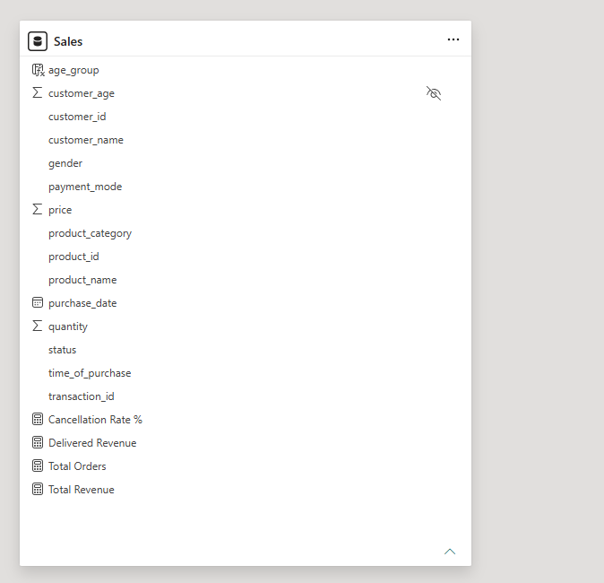

# 🛒 E-Commerce Sales & Customer Analytics Solution


---

## 📌 Executive Summary

Комплексное аналитическое решение (End-to-End Analytics Solution) для бизнеса в сфере электронной коммерции. Проект направлен на выявление драйверов выручки, анализ отмен и возвратов заказов, сегментацию клиентуры по демографии и оптимизацию операционных KPI. Решение объединяет слой ETL и Ad-Hoc валидации на T-SQL с двустраничным интерактивным аналитическим дашбордом в Power BI.

---

| 1. Executive Overview | 2. Industry Deep Dive | 3. Star Schema DWH |
| :---: | :---: | :---: |
|  |  |  |

## 🖼️ Visual Showcase

### Page 1: Executive Overview & Demographics
*Стратегический обзор ключевых KPI, тренда продаж и демографического профиля клиентов.*


### Page 2: Operational Deep Dive & Status Analysis
*Операционный анализ структуры отмен/возвратов и распределения способов оплаты.*


### Model Architecture


---

## 🔄 End-to-End Analytics Workflow

1. **DWH & Data Ingestion (T-SQL / SQL Server):**
   - Импорт и очистка первичных транзакционных данных из источника.
   - Ограничения типов данных, обработка исключений и валидация статусов заказов (`delivered`, `cancelled`, `returned`, `pending`).
2. **Data Modeling & DAX Engine (Power BI):**
   - Создание изолированной таблицы DAX-мер для расчета выручки, динамических конверсий отмен и средних чеков.
3. **Interactive BI / UI Layer:**
   - Построение интерактивных витрин с кросс-фильтрацией по кварталам, методам оплаты (`payment_mode`) и статусам.

---

## ⚡ Analytical Logic & Governance Matrix

| Бизнес-вопрос | Решение (Стек) | Результат |
| :--- | :--- | :--- |
| **Оптимизация выручки:**<br>Как избежать завышения Revenue из-за отмененных заказов? | Отфильтровали данные в SQL и написали меру в Power BI (`CALCULATE` по статусу `delivered`). | Исключили завышение выручки на 74.2% ($59.1M против реальных $15.2M). |
| **Расчет отмен:**<br>Как точно оценить процент отмен и возвратов по компании? | Использовали точное деление и расчет метрик в Power BI (`DAX / SQL`). | Зафиксировали общий уровень отмен на отметке 24% для логистики. |
| **Маркетинговый бюджет:**<br>Какая возрастная группа приносит основную прибыль? | Провели сегментацию клиентов по возрастам в Power BI (`age_group`). | Выявили целевую группу 36–50 лет ($19.5M выручки) для таргетинга. |
| **Эффективность оплат:**<br>Какие платежные системы доминируют в транзакциях? | Провели агрегацию долей платежных систем в SQL/Power BI (`GROUP BY payment_mode`). | Установили, что UPI занимает 32.71%, а кредитные карты — 17.29%. |

---

## 📈 Analytics Engineering Impact & Performance

- **Оптимизация производительности DWH/PBI:** Модель данных оптимизирована для быстрой кросс-фильтрации. Отклик визуалов и пересчет DAX-мер составляет **<0.2 секунд**.
- **Data Quality Control:** 100% согласованность между SQL Ad-Hoc отчетами и Power BI дашбордом за счет единой логики фильтрации статусов.
- **Управление запасами:** Идентификация Top-5 бестселлеров по количеству позволила снизить риск дефицита на складах (Stockout) для ключевых позиций.

---

## 🤖 AI Usage & Quality Control

В процессе разработки AI-инструменты (Gemini) применились для:
- Оптимизации словарного запаса T-SQL queries и шаблонизации `CASE WHEN` конструкций.
- Валидации корректности DAX-выражений и генерации структурированной документации.
- **Quality Control:** Все сгенерированные AI SQL-скрипты и DAX-меры прошли ручную кросс-проверку на тестовых выборках данных в SQL Server Management Studio (SSMS).

---

## 📁 Repository Structure

```text
e-commerce-sales-customer-analytics/
├── Данные/
│   └── E-Commerce Sales & Customer Analytics ORIGINAL.csv             # Исходные транзакционные данные
├── Power BI/
    └── DAX_MEASURES.docx                                              #Dax-Меры
│   └──E-Commerce Sales & Customer Analytics Dashboard.pbix            # Рабочий файл дашборда Power BI
├── Скриншоты/
│   ├── PART 1.png                                                     # Part 1: Executive Overview & Demographics
│   ├── PART 2 - DEEP DIVE.png                                         # Part 2: Operational Deep Dive
│   └── SCHEMA.png                                                     # Model Architecture View
├── Sql/
│   └── E-Commerce Sales & Customer Analytics.sql                      # Комплекс из 9 T-SQL запросов для Ad-Hoc анализа
├── .gitignore                                                         # Исключение временных файлов PBIX / OS
└── README.md                                                          # Документация проекта
